# Cahier des charges : « Mat & Méthode » (application Python)

Document destiné à Claude Code. Il décrit une **application de bureau Windows 11, écrite en Python et livrée en fichier `.exe`**, qui aide un technicien de laboratoire à décrire une manip de prétraitement (étapes, conditions, réactifs, échantillons, laboratoires, analyses) et à produire automatiquement la section « Matériel et méthodes » et un PDF avec le schéma du flux.

**Nom du logiciel : « Mat & Méthode »** (titre de la fenêtre, barre de titre, « À propos », exports). Pour les noms de fichiers, dossiers et code, utiliser **`MatMethode`** (sans `&` ni accents, qui posent problème dans les chemins et sur SharePoint) : `MatMethode.exe`, dossier `MatMethode_1.0\`, paquet Python `mat_methode`. Les anciens libellés « Cahier de manip » des visuels `V01` à `V13` sont à remplacer par le nouveau nom.

Deux références existent :

- **Comportement et libellés** : un prototype web fonctionnel (`prototype/index.html`, visuels `V01` à `V13`, thème sombre).
- **Design** : les maquettes **Windows 11** (`visuels/windows11/`, `W01` à `W07`, thèmes clair et sombre). **Elles priment pour l'apparence** ; le prototype web ne sert qu'à comprendre le comportement.

L'application doit reproduire le comportement du prototype avec le design Windows 11, puis corriger les points du §14.

---

## 0. Comment travailler (consignes pour Claude Code)

1. Lis ce document en entier, puis ouvre `prototype/index.html` dans un navigateur et manipule-le (il est autonome, aucune dépendance, données d'exemple incluses).
2. Regarde les maquettes Windows 11 `visuels/windows11/W01` à `W07` (design à reproduire) et les visuels `V01` à `V13` (comportement).
3. **Avant de coder, pose à l'utilisateur les questions du §15** (plateforme cible, formats des numéros, etc.). Si aucune réponse, prends les choix par défaut indiqués.
4. Construis d'abord la couche métier sans interface (§9), avec des tests qui utilisent les fichiers de `exemples/` comme références (« golden files »).
5. Puis l'interface, puis les exports, puis l'import de rapports PDF.
6. **Plateforme : Windows uniquement, livraison en `.exe`** (§9). Pas de web, pas de mobile.
7. L'utilisateur trouve les logiciels « trop compliqués » : **ne rajoute pas de fonctions ni d'écrans non demandés**. En cas de doute, garde le plus simple et pose la question.
8. Tout le texte de l'interface et des documents est en **français**.

---

## 1. Contexte et objectif

Un technicien réalise des manips de prétraitement d'une matière (exemple type : graisse animale : chauffage, filtration, désacidification au solvant, décantation, séchage). Pour chaque manip il doit rédiger un « Matériel et méthodes » et suivre les échantillons envoyés à des laboratoires (interne ou externe) pour analyse, chacun avec un numéro **Scirius** et un numéro **Aramis**.

Aujourd'hui c'est fait à la main. L'application doit :

- se **saisir étape par étape** dans un flux (pas dans un gros formulaire) ;
- **générer** le texte « Matériel et méthodes » et un **PDF** montrant le flux, avec les prélèvements placés à leur moment ;
- garder une **bibliothèque** des manips passées (dupliquer, modifier le flux, exporter, archiver) ;
- **importer** un ancien rapport PDF pour pré-remplir une manip.

## 2. Utilisateur et usage

- Un seul utilisateur principal (technicien), qui parle français, travaille au laboratoire **sur un PC Windows** (souris et clavier).
- Niveau informatique : bon utilisateur, pas développeur. Il veut peu d'écrans, de gros boutons, aucun jargon.
- Il saisit en laboratoire entre deux manipulations : saisie rapide au clavier (Tab, Entrée, Échap), enregistrement automatique, aucune perte de données si l'on ferme la fenêtre.
- Données sensibles de laboratoire : pas de collecte externe, pas de télémétrie.

## 3. Périmètre

### Inclus (MVP = le prototype)
Bibliothèque, définition du flux, compléments par étape (conditions, réactifs, échantillons), bilan de volume, rapport généré, exports (texte, HTML imprimable, JSON, **PDF avec flux**), réglages (laboratoires, réactifs, analyses, donneurs d'ordre), import d'un ancien rapport PDF (via JSON d'extraction), enregistrement local, **fichier `.exe` portable pour Windows 11 (sans installateur)**.

### Hors périmètre (pour l'instant)
Version web ou mobile, comptes multi-utilisateurs, droits, synchronisation SharePoint/Excel, OCR de PDF scannés, impression d'étiquettes, traçabilité réglementaire (journal d'audit), anglais. À mentionner dans la feuille de route (§16), sans les coder.

## 4. Vocabulaire

| Terme | Sens |
|---|---|
| **Manip** | Une expérience complète : contexte + flux + échantillons. |
| **Flux** | Suite ordonnée d'**étapes** (chauffage, filtration…). |
| **Étape** | Une opération avec ses conditions opératoires, ses réactifs et ses prélèvements. |
| **Départ / Entrée** | Matière avant traitement. Peut avoir des échantillons « avant traitement ». |
| **Effluent** | Ce qui sort de l'étape (sortie). Un prélèvement « à l'effluent » est pris à la fin de l'étape. |
| **Prélèvement / Échantillon** | Volume prélevé à un moment précis, envoyé à un laboratoire pour des analyses. |
| **Moment** | `avant` (entrée), `pendant` (à t minutes depuis le début de l'étape), `effluent` (sortie). |
| **Donneur d'ordre** | Service ou client qui a demandé la manip (ex. « Interne · R&D »). |
| **Scirius, Aramis** | Deux numéros d'échantillon propres à l'organisation (formats à confirmer, §15). |
| **Conditions communes** | Conditions identiques pour tout le flux (ex. agitation 300 tr/min), appliquées d'un coup. |
| **FFA** | Acides gras libres (analyse courante). |

## 5. Parcours utilisateur

1. **Créer ou ouvrir** une manip (Mes manips). Choisir le **donneur d'ordre** (liste des Réglages), saisir la référence et le volume de départ.
2. **Définir le flux** : ajouter les étapes dans l'ordre (boutons d'opérations), éventuellement régler les **conditions communes** puis les appliquer à tout le flux.
3. **Compléter chaque étape** : conditions opératoires → réactifs → échantillons à prélever (labo, analyses, numéros). Naviguer avec « Étape suivante ».
4. **Rapport** : lire le texte généré, repérer ce qui reste « à saisir », copier ou exporter.
5. **Plus tard** : dupliquer la manip, modifier son flux, l'archiver.

Régler une fois pour toutes dans **Réglages** : laboratoires (volume et analyses par défaut), noms de réactifs, analyses, donneurs d'ordre.

---

## 6. Écrans (avec visuels)

**Navigation Windows 11 (NavigationView)** : un volet à gauche remplace les onglets du prototype. Éléments : **Mes manips · Flux · Rapport**, et **Réglages** en bas (convention Windows 11). En haut du volet, une carte « Manip ouverte » rappelle le nom, le statut, le nombre d'étapes et d'échantillons. « Flux » et « Rapport » exigent une manip ouverte. Le volet se replie en icônes quand la fenêtre fait moins de 1000 px de large.

### 6.0 Design Windows 11 : maquettes de référence (W01 à W07)

| Visuel | Écran | Points de design |
|---|---|---|
| `W01` | Mes manips | Liste de cartes (ListView), barre de commandes (Nouvelle manip en bouton d'accentuation, Importer), recherche, onglets Actives/Archivées, pastilles de statut, menu « … » (Dupliquer, Exporter, Archiver, Supprimer). |
| `W02` | Flux, **Définir** | Bandeau « Ma demande », sélecteur à deux onglets (Pivot), liste des étapes avec ComboBox d'opération et boutons carrés Monter/Descendre/Dupliquer/Supprimer, « Insérer après », grille d'opérations, carte « Conditions communes » avec **ToggleSwitch** et NumberBox. |
| `W03` | Flux, **Compléter** (clair) | **Maître-détail** : à gauche le flux en cartes verticales (frise, badges, pastilles de prélèvement), à droite l'éditeur de l'étape en trois cartes repliables (**Expander**) : Conditions, Réactifs, Échantillons. |
| `W04` | Rapport | InfoBar d'avertissement (« 8 numéros restent à saisir »), texte avec pastilles « à saisir », **fiches « Détail par phase du flux »** (Départ, puis chaque étape : réactifs et échantillons), tableaux récapitulatifs. |
| `W05` | Réglages | Page de réglages en Expanders : Laboratoires, Réactifs (noms), Analyses, Donneurs d'ordre. |
| `W06` | Flux, Compléter, **thème sombre** | Même écran en sombre : l'application suit le thème de Windows. |
| `W07` | Fenêtre d'export | **ContentDialog** modale avec scrim. |

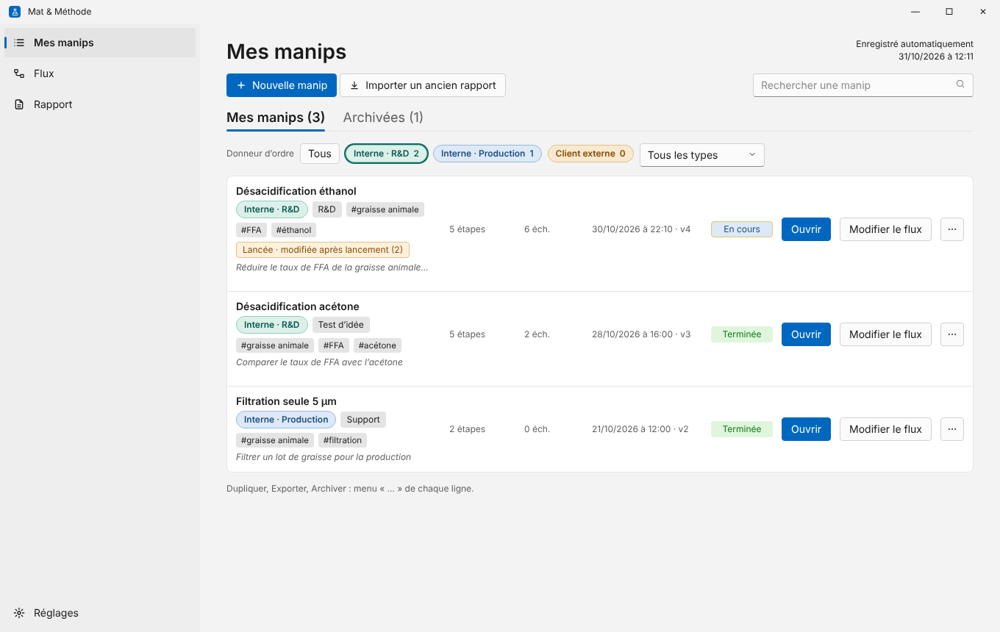
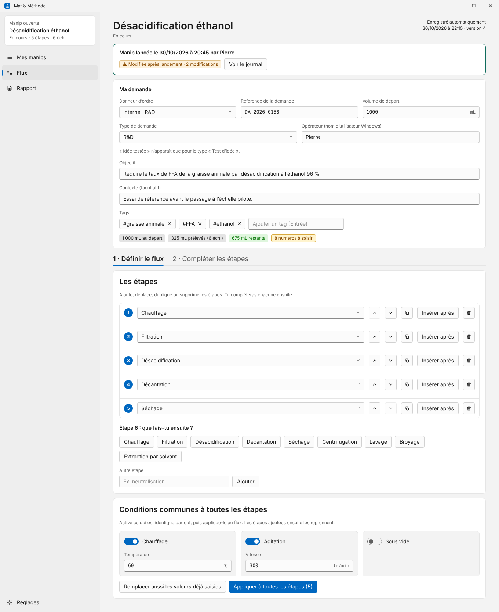
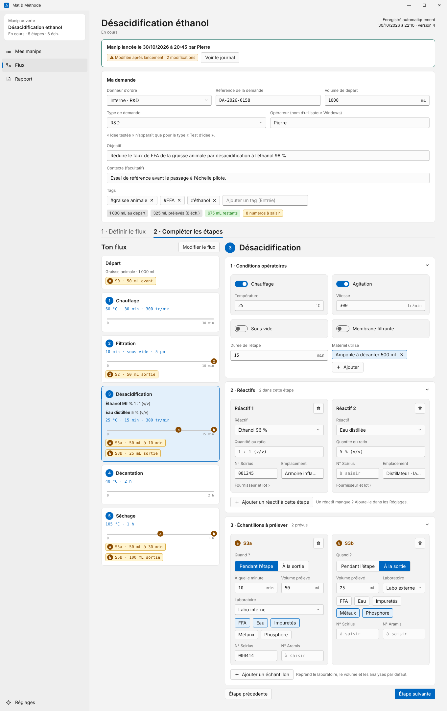
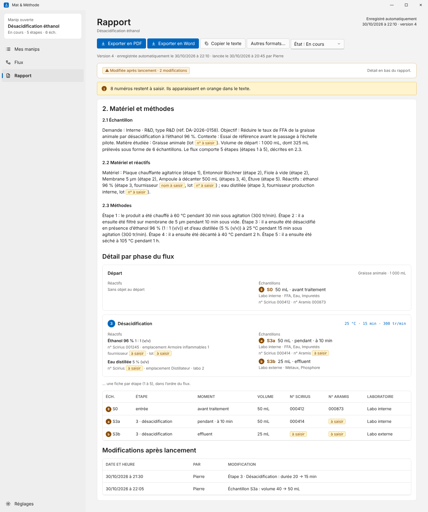
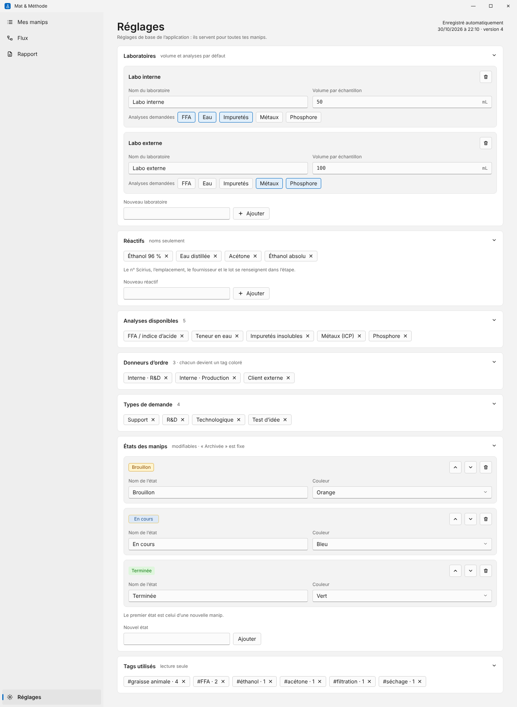
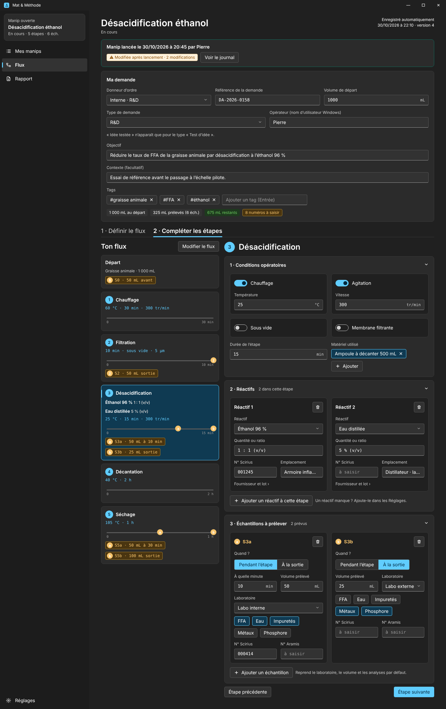
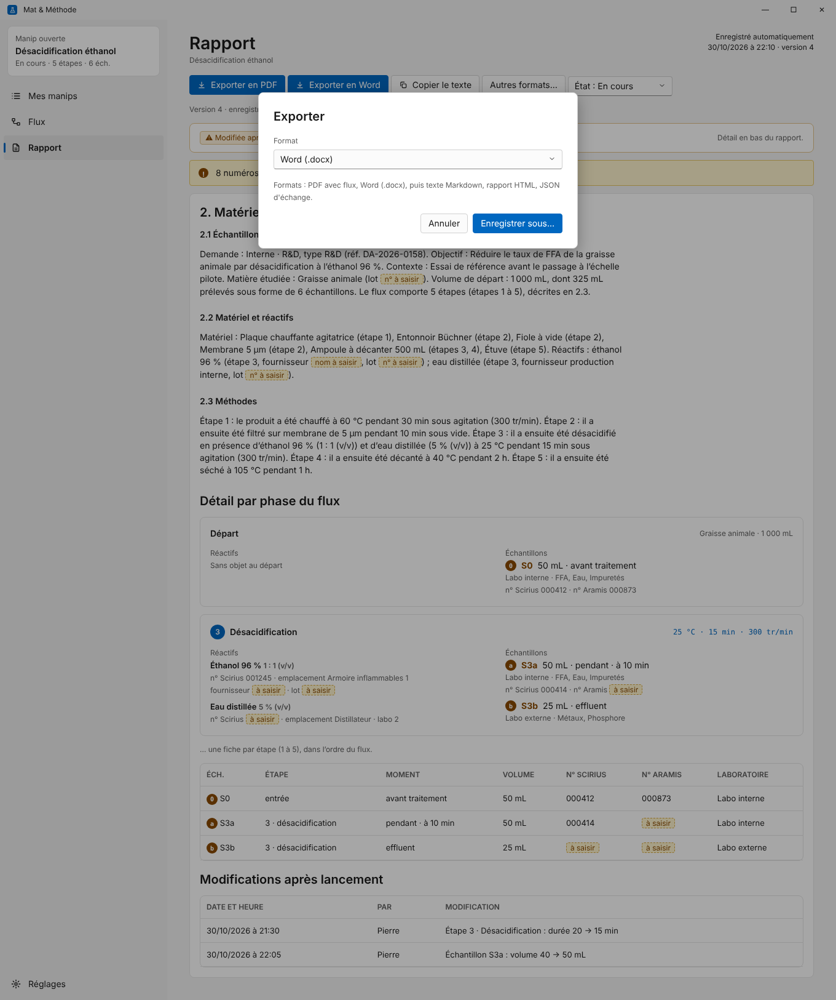

**Correspondance des contrôles** (prototype → Windows 11) :

| Prototype web | Contrôle Windows 11 |
|---|---|
| Onglets du haut | NavigationView (volet gauche) ; « Définir / Compléter » = Pivot |
| Boutons à bascule (Chauffage, Agitation, Sous vide…) | **ToggleSwitch** + NumberBox qui apparaît quand activé |
| Listes (donneur d'ordre, réactif, laboratoire) | ComboBox (liste fermée) |
| Champs numériques | NumberBox avec unité |
| Pastilles d'analyses | ToggleButton (ou cases à cocher) |
| « Pendant l'étape / À la sortie » | SegmentedControl |
| Messages temporaires | InfoBar / notification « teaching tip » |
| Fenêtres | ContentDialog |
| Sections repliables | Expander |
| Cartes du flux (défilement horizontal) | Cartes verticales dans le volet gauche du maître-détail (sur PC) |

Les écrans décrits ci-dessous gardent leur **comportement** (§6.1 à §6.6) ; seul le contrôle change.

### 6.1 Mes manips (V01)
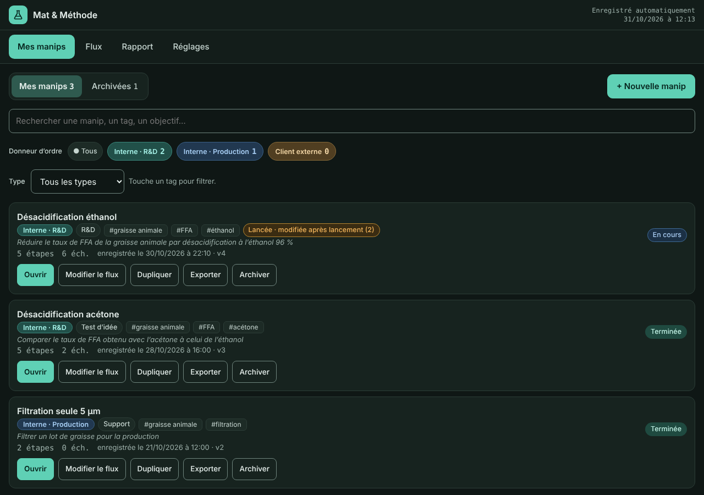

- Filtre « Mes manips » / « Archivées » avec compteurs, recherche (nom, donneur d'ordre, référence, type, objectif, tags).
- **Un tag coloré par donneur d'ordre** : rangée de boutons-tags « Tous · Interne · R&D 2 · Interne · Production 1 · Client externe 0 » (compteur = nombre de manips actives). Un clic filtre ; un second clic sur « Tous » retire le filtre. Chaque donneur a **sa couleur** (attribuée par son rang dans la liste des Réglages, palette de 6 teintes qui se répète) ; le même tag coloré est affiché sur chaque manip.
- Filtre **Type de demande** (liste déroulante) et filtre **tag** : toucher un tag (`#FFA`) sur une manip filtre la liste, une pastille « Tag : FFA × » permet de le retirer.
- Pour chaque manip : nom, tag du donneur d'ordre, type de demande, tags libres (`#graisse animale`), objectif (une ligne en italique), nombre d'étapes, nombre d'échantillons, **date et heure du dernier enregistrement et numéro de version** (« enregistrée le 30/10/2026 à 22:10 · v4 »), pastille **« Lancée · modifiée après lancement (n) »** (orange) si la manip a été lancée puis modifiée, **état** (pastille colorée ; les états se règlent dans Réglages, §8.8).
- Boutons par manip : **Ouvrir** (va au Flux, mode « Compléter » si des étapes existent, sinon « Définir »), **Modifier le flux** (mode « Définir »), **Dupliquer**, **Exporter**, **Archiver / Restaurer**, **Supprimer** (archivées seulement, avec confirmation).
- **Dupliquer** : copie nommée « … (copie) », premier état de la liste (Brouillon par défaut), copie aussi le type, l’objectif et les tags, **vide la référence, le lot et tous les n° Scirius/Aramis** (le reste est conservé : étapes, conditions, réactifs, prélèvements, laboratoires, analyses).
- En bas : « Importer un ancien rapport » (JSON issu de l'extraction PDF) et « Restaurer les exemples ».
- « + Nouvelle manip » : fenêtre avec nom et « Partir de » (vide ou une manip existante = copie).

### 6.2 Flux, mode 1 « Définir le flux » (V02, design W02)
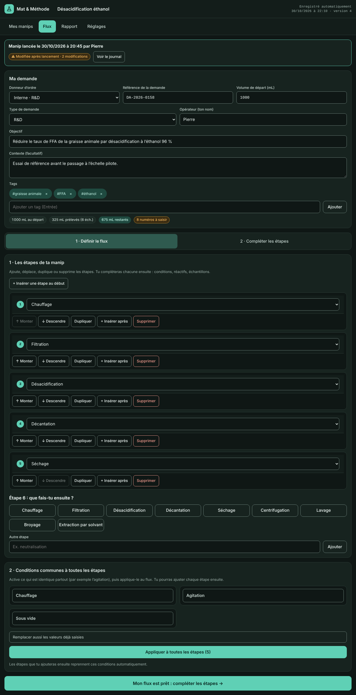

Au-dessus de « Ma demande », la bande **Lancement** (voir §8.9) : bouton **▶ Lancer la manip** tant qu'elle n'est pas lancée ; ensuite « Manip lancée le 31/10/2026 à 12:11 par Pierre » avec la pastille orange **« ⚠ Modifiée après lancement · 5 modifications »** et le bouton **Voir le journal** (ou, s'il n'y a eu aucune modification, la pastille verte « Aucune modification depuis le lancement » et le bouton Annuler le lancement).

Bandeau **Ma demande** : donneur d'ordre (**liste fermée**, définie dans Réglages ; non modifiable ici), référence de la demande, volume de départ (mL), puis :
- **Opérateur** : le nom de la personne qui réalise la manip (dans l'application Windows : **nom d'utilisateur Windows**, rempli automatiquement et modifiable) ; il signe le lancement et le journal ;
- **Type de demande** (liste fermée dans Réglages : Support, R&D, Technologique, Test d'idée) ;
- **Idée testée** (champ texte, **affiché seulement** si le type contient « test », par ex. « Test d'idée ») ;
- **Objectif** (une ligne) et **Contexte** (texte libre, facultatif) ;
- **Tags** : étiquettes libres, ajout par la touche Entrée ou le bouton Ajouter (plusieurs d'un coup séparés par des virgules), retrait par ×, **suggestions** des tags déjà utilisés (liste de saisie) ; la casse et les accents ne créent pas de doublon (« FFA » et « ffa » = un seul tag) ;
- puces de bilan (voir §8.3).

Sélecteur large : « 1 · Définir le flux » / « 2 · Compléter les étapes ».

Bloc **1 · Les étapes** : liste numérotée ; pour chaque étape : choix de l'opération (liste) et boutons **Monter, Descendre, Dupliquer, + Insérer après, Supprimer**. Bouton « + Insérer une étape au début ». Question guidée « Étape N : que fais-tu ensuite ? » avec une grille de boutons d'opérations (Chauffage, Filtration, Désacidification, Décantation, Séchage, Centrifugation, Lavage, Broyage, Extraction par solvant) et un champ « Autre étape ». En mode insertion, la question devient « Insérer après l'étape k » et chaque ajout s'insère à la suite (bouton « Annuler l'insertion »).

Bloc **2 · Conditions communes à toutes les étapes** : bascules Chauffage (°C), Agitation (tr/min), Sous vide (mbar facultatif) ; bascule « Remplacer aussi les valeurs déjà saisies » ; bouton « Appliquer à toutes les étapes (N) ». Les étapes ajoutées ensuite reprennent ces conditions.

Bouton final « Mon flux est prêt : compléter les étapes → ».

### 6.3 Flux, mode 2 « Compléter les étapes » (V03 à V06, design W03)
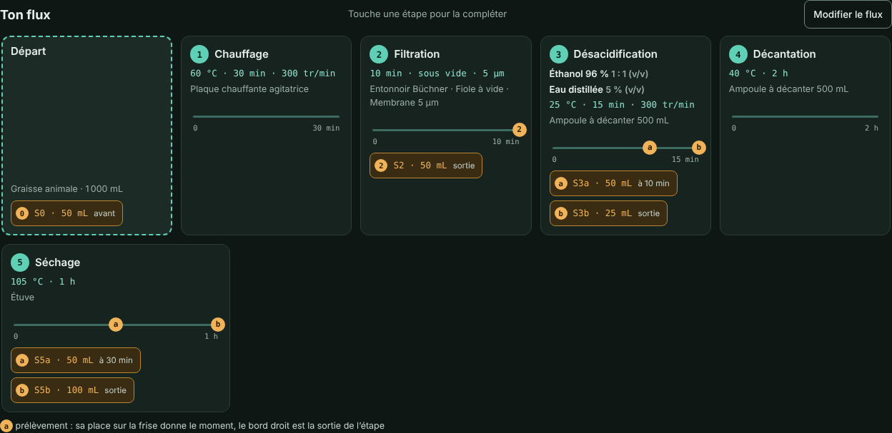

Le **flux en cartes** (sur PC, **maître-détail** : liste verticale à gauche, éditeur à droite, voir W03) : carte « Départ » puis une carte par étape. Chaque carte montre : numéro, opération, réactifs (nom + quantité), résumé des conditions (ou « conditions à compléter »), matériel, **frise du temps** (voir §8.4) et pastilles des échantillons. Cliquer une carte ouvre l'éditeur à droite. Bouton « Modifier le flux » (retour au mode 1).

Éditeur de l'étape (trois blocs) :

**1 · Conditions opératoires** (V04)
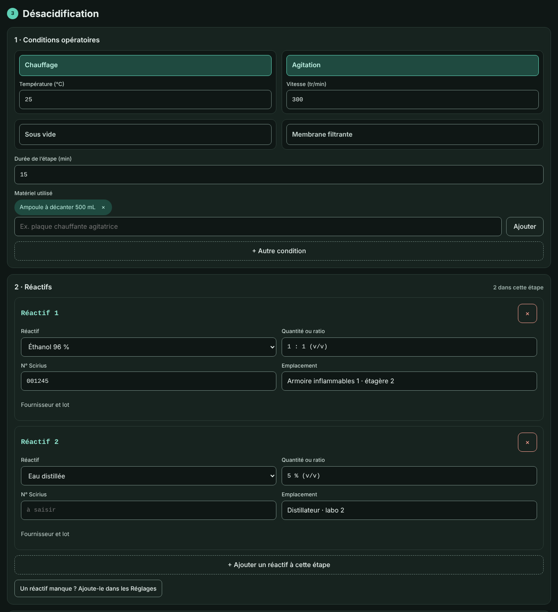
- Boutons à bascule : Chauffage, Agitation (« Vitesse de centrifugation » pour la centrifugation), Sous vide, Membrane filtrante. Activer une bascule affiche son champ (défauts à l'activation : 60 °C, 300 tr/min, 5 µm ; sous vide : pression facultative en mbar). Désactiver efface la valeur.
- **Durée de l'étape** (min), toujours visible.
- **Matériel utilisé** : pastilles supprimables + champ avec suggestions tirées des autres manips.
- **Autres conditions** : lignes libres « nom / valeur » (ex. pH 7, atmosphère azote).

**2 · Réactifs** (V04)
- Autant de réactifs que nécessaire. Le **nom se choisit dans la liste des Réglages** (liste fermée ; lien « Un réactif manque ? Ajoute-le dans les Réglages »). Champs : quantité ou ratio (texte libre, ex. « 1 : 1 (v/v) »), **n° Scirius**, **emplacement**, et dans un volet repliable **fournisseur** et **lot**.
- Scirius, emplacement, fournisseur et lot sont **mémorisés par nom de réactif** et repris dans toutes les étapes et manips qui utilisent ce réactif.

**3 · Échantillons à prélever** (V05)
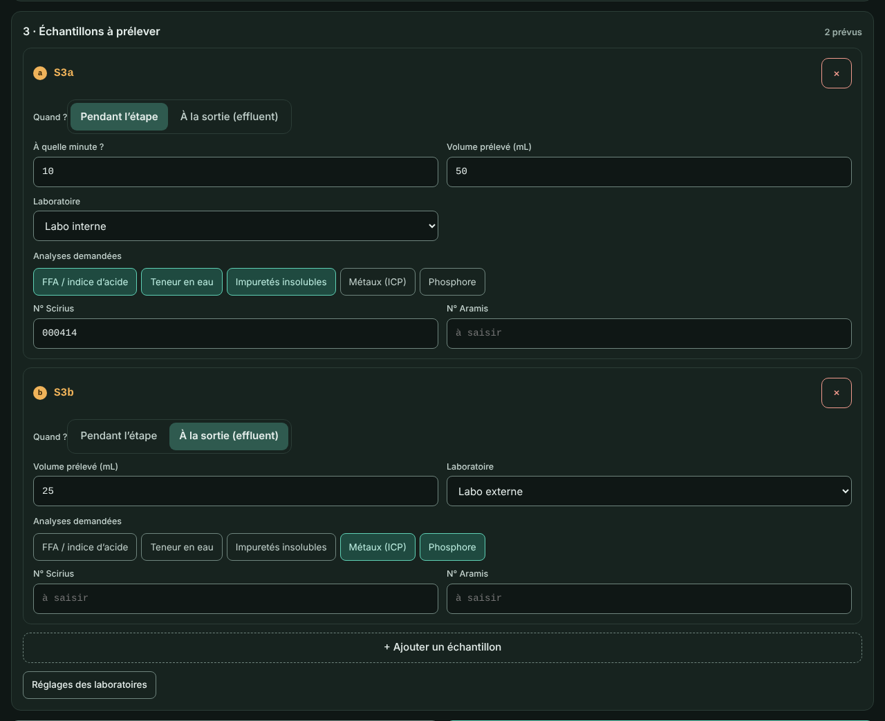
- Par échantillon : code (S3a…), **Quand ?** (« Pendant l'étape » avec « À quelle minute ? » ou « À la sortie (effluent) »), volume (mL), laboratoire, analyses (bascules), n° Scirius, n° Aramis.
- Choisir un **laboratoire** applique son volume et ses analyses par défaut (Réglages). « + Ajouter un échantillon » reprend le laboratoire du dernier échantillon créé et ses valeurs par défaut.
- Lien « Réglages des laboratoires ».

Navigation : « ← Précédente » / « Étape suivante → » ; sur la dernière étape, « Terminer : voir le rapport ».

**Départ** (V06) : mêmes champs de matière (matière, lot) et échantillons « avant traitement » (sans choix de moment).
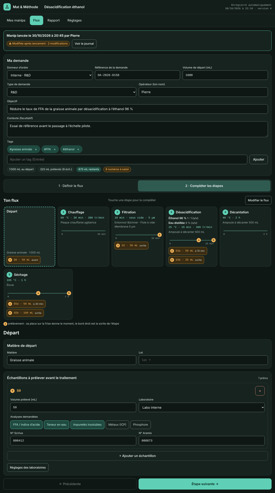

### 6.4 Rapport (V07, V09)
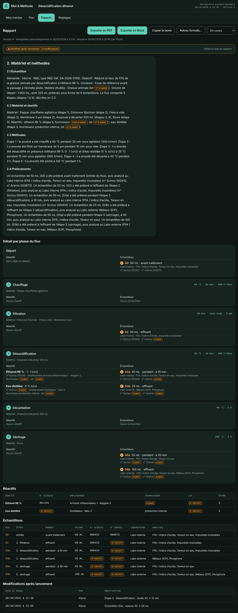

Texte « 2. Matériel et méthodes » généré (§10), puis **« Détail par phase du flux »** : une fiche par phase (**Départ**, puis étape 1 à n, dans l'ordre du flux) avec ses conditions, son matériel, ses **réactifs** (quantité, n° Scirius, emplacement, fournisseur, lot) et ses **échantillons** (volume, moment, laboratoire, analyses, n° Scirius et Aramis), puis les tableaux récapitulatifs **Réactifs** et **Échantillons**. Les informations manquantes apparaissent comme pastilles orange « à saisir » (jamais de valeur inventée). Boutons : **Exporter en PDF** et **Exporter en Word** (boutons principaux, un clic = fichier enregistré), **Copier le texte** (Markdown), **Autres formats…** (fenêtre : PDF, Word, puis Markdown, HTML imprimable, JSON), une liste déroulante **État de la manip** (les états définis dans Réglages ; plus de bouton « Marquer comme terminée »).

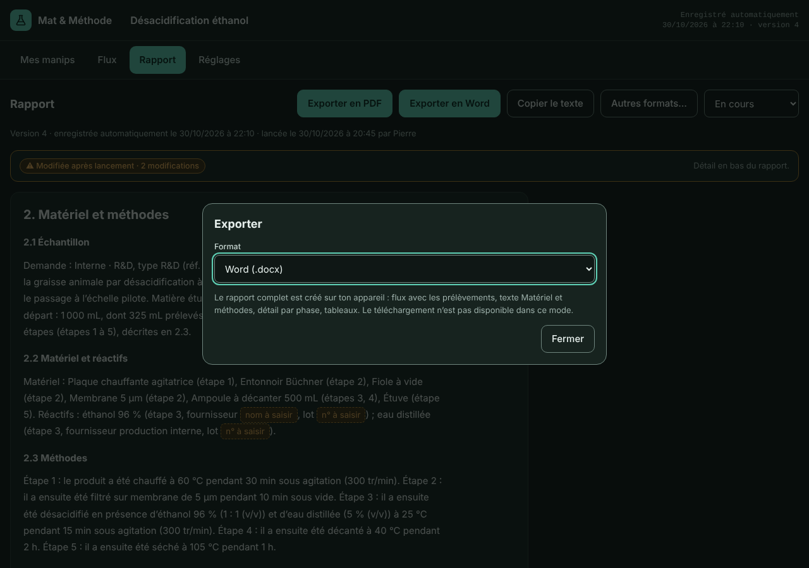

### 6.5 Réglages (V08)
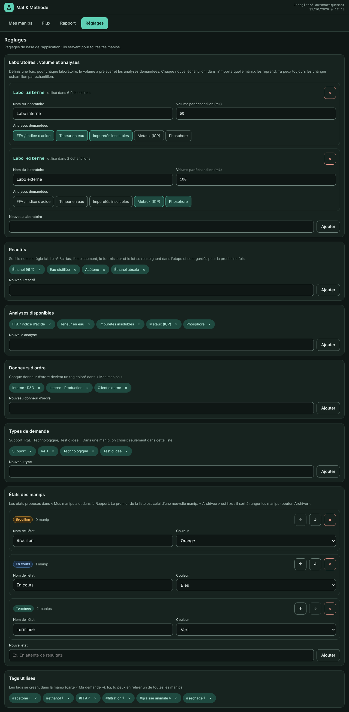

Réglages de base de l'application, valables pour toutes les manips :
- **Laboratoires** : nom, **volume par échantillon (mL)**, **analyses demandées** par défaut. Ajouter, renommer (met à jour les échantillons existants), supprimer.
- **Réactifs** : **seulement le nom** (liste de choix). Les autres informations se renseignent dans l'étape.
- **Analyses disponibles** : liste commune (ajouter/supprimer ; la suppression retire aussi l'analyse des laboratoires).
- **Donneurs d'ordre** : liste de choix pour « Ma demande ». Chaque donneur devient un **tag coloré** dans Mes manips.
- **Types de demande** : liste de choix (Support, R&D, Technologique, Test d'idée par défaut ; ajout, suppression).
- **États des manips** : liste **modifiable** (nom, couleur parmi Neutre / Bleu / Vert / Orange / Rouge, ordre avec ↑ ↓, ajout, suppression). Par défaut : Brouillon (orange), En cours (bleu), Terminée (vert). Le **premier** de la liste est l'état d'une nouvelle manip, d'une copie et d'une manip restaurée. Supprimer un état déplace ses manips vers le premier état restant (message « 2 manips passées en … ») ; il faut en garder au moins un. **« Archivée » est fixe** (hors liste) : il pilote l'onglet Archivées.
- **Tags utilisés** : lecture seule + retrait d'un tag de toutes les manips (les tags se créent dans la manip).

Les éléments des Réglages ne sont **pas modifiables depuis une manip** (liste fermée), sauf lien vers les Réglages.

### 6.6 Fenêtres
Nouvelle manip, Importer un ancien rapport (zone de collage JSON, message d'erreur clair), Exporter, Confirmation (suppression, restauration des exemples). Fermeture par Échap ou clic hors de la fenêtre. Messages brefs (« toasts ») : « Copie créée », « Appliqué à 3 étapes », etc.

---

## 7. Modèle de données

Entités (types indicatifs ; un équivalent `pydantic` ou `dataclass` est attendu) :

```text
Reglages
  laboratoires: [ {nom, volume_ml, analyses:[str]} ]
  analyses:     [str]
  donneurs_ordre: [str]            # chacun = un tag coloré dans Mes manips
  types_demande: [str]             # Support, R&D, Technologique, Test d'idée
  etats: [ {id, nom, ton} ]       # ton: neutre|info|ok|warn|danger ; le 1er = état initial ; « archivee » hors liste
  reactifs:     [ {nom, scirius, emplacement, fournisseur, lot} ]   # seul "nom" se règle dans Réglages

Manip
  id, nom, etat (id d'un état des Réglages, ou « archivee »), maj (datetime)
  schema (int), rev (int = n° de version, +1 à chaque enregistrement), maj (date-heure du dernier enregistrement), modifie_par (utilisateur Windows)
  lancee: null | {le: datetime, par: str}
  journal: [ {t: datetime, par: str, txt: str} ]   # ajout seulement (§8.9)
  base: str                        # photo de référence du contenu suivi, mise à jour à chaque ligne de journal
  tags: [str]                      # libres, sans doublon (casse/accents ignorés)
  contexte: {donneur, type, objectif, idee, precisions, ref, date, operateur, volume_depart_ml, matiere, lot}
  communes: {temperature_c?, agitation_trmin?, vide? {mbar?}}
  etapes: [Etape]            # ordre = ordre du flux
  prelevements: [Prelevement]

Etape
  id, operation (str, catalogue ou libre)
  temperature_c?, duree_min?, agitation_trmin?, filtre_um?
  vide?: {mbar?}             # présent = « sous vide »
  equipements: [str]
  autres: [ {nom, valeur} ]
  reactifs: [ {nom, quantite} ]          # nom pris dans Reglages.reactifs
  remarque

Prelevement
  id
  etape_id | null            # null = entrée (avant traitement)
  moment: avant|pendant|effluent
  temps_min?                 # seulement si moment = pendant
  volume_ml, labo, analyses: [str], scirius?, aramis?
```

L'**étiquette d'un échantillon** (S3a, S0…) **n'est pas stockée** : elle se calcule (§8.1).

### Format d'échange JSON
L'export JSON du prototype (`exemples/manip-pour-script-pdf.json`) sert à la fois à produire le PDF et à ré-importer une manip. Clés : `titre, contexte, etapes[] {n, operation, parametres{temperature_c, duree_min, agitation_trmin, filtre_um, vide, vide_mbar}, equipement[], reactifs[], reactifs_detail[], remarque}, sous_sections[], materiel[], reactifs[], prelevements[] {id, apres_etape, moment, temps_min, volume_ml, scirius, aramis, labo, analyses[]}, phases[] {titre, conditions, materiel[], reactifs[] {nom, quantite, scirius, emplacement, fournisseur, lot}, echantillons[] {id, volume, moment, labo, analyses[], scirius, aramis}}, inventaire_reactifs[]`. Le PDF reconstruit les phases à partir de `etapes`, `prelevements` et `inventaire_reactifs`. Ce format doit rester compatible avec `scripts/export_pdf_flux.py` et `scripts/extract_mm.py`.

---

## 8. Règles métier

### 8.1 Étiquettes des échantillons
`S` + numéro d'étape (0 pour l'entrée) ; s'il y a plusieurs échantillons dans la même étape, suffixe `a, b, c…`. Ordre dans une étape : `avant` < `pendant` (par temps croissant) < `effluent`. Exemple : étape 3 avec un échantillon à 10 min et un à l'effluent → `S3a`, `S3b` ; étape 2 avec un seul échantillon → `S2`. Les étiquettes se recalculent quand on déplace, insère ou supprime des étapes. **Code du badge** : suffixe lettre s'il existe, sinon le numéro (S3a → « a », S2 → « 2 », S0 → « 0 »).

### 8.2 Suppression
Supprimer une étape supprime ses échantillons. Supprimer un laboratoire ou une analyse des Réglages ne supprime pas les échantillons existants (le libellé reste affiché).

### 8.3 Bilan de volume
`restant = volume_depart − Σ volumes prélevés`. Puces : « X mL au départ », « Y mL prélevés (n éch.) », « Z mL restants » (orange si négatif : « dépassement de … mL »), et « N numéros à saisir » (= nombre de n° Scirius vides + nombre de n° Aramis vides, tous échantillons).

### 8.4 Frise du temps (carte d'étape et PDF)
Barre de 0 à `duree_min`. Badge d'un prélèvement `pendant` à `temps/duree` (borné à 0–100 %) ; `pendant` sans temps connu → milieu ; `effluent` → extrémité droite. Une étape sans durée mais avec prélèvements affiche quand même la frise (extrémité « fin »).

### 8.4 bis Titre d'une étape dans la carte du flux
Le nom de l'étape **s'adapte à la largeur de la carte** : il passe à la ligne **entre les mots** (« Chauffage préalable de la graisse brute » sur 2 ou 3 lignes) ; si un seul mot est plus large que la carte (« Électrocoagulation »), la police est **réduite par pas de 0,5 pt jusqu'à un minimum** (11 px à l'écran, 6 à 6,5 pt dans le PDF) avant de couper. On ne coupe jamais un mot au milieu à l'écran. La carte **grandit en hauteur** avec le nombre de lignes du titre, et tout le contenu (réactifs, conditions, frise, badges) est décalé vers le bas, dans l'écran, le PDF et l'image du flux du Word. Le champ « Nom » de l'étape n'a pas de limite de longueur imposée.

### 8.5 Conditions communes
« Appliquer » : pour chaque étape, écrire la condition active **seulement si vide**, sauf si « Remplacer aussi… » est activé. **L'agitation ne s'applique pas à la centrifugation** (sa « vitesse » est propre). Une étape créée ensuite hérite des conditions communes actives.

### 8.6 Laboratoires par défaut
Créer un échantillon : laboratoire = celui du dernier échantillon de la manip (sinon le premier de la liste) ; volume = volume par défaut du laboratoire (sinon 50 mL) ; analyses = celles du laboratoire (sinon celles du dernier échantillon). Changer le laboratoire d'un échantillon réapplique volume et analyses du laboratoire.

### 8.7 Listes fermées
Donneur d'ordre, laboratoire et nom de réactif se **choisissent** dans des listes. Si la valeur d'une manip existante n'est plus dans la liste, elle reste affichée comme option. Les noms de réactifs ajoutés par l'**import** d'un ancien rapport sont ajoutés automatiquement à la liste.

### 8.7 bis Tags
Un tag est une chaîne courte sans « # » (le « # » n'est qu'un affichage). Comparaison sans casse ni accents ; l'orthographe déjà utilisée ailleurs est reprise. Dupliquer une manip **copie** type, objectif, idée, contexte et tags (comme le reste) ; la référence, le lot et les numéros restent vidés.

### 8.8 Statuts et sauvegarde
Le premier état des Réglages par défaut ; changement d'état par la liste du Rapport ; Archivée via la bibliothèque (Restaurer = premier état). Toute modification est enregistrée automatiquement (délai < 1 s) ; l'état « Enregistrement… / Enregistré » est visible. **L'enregistrement est entièrement automatique** : il n'y a **pas de bouton « Enregistrer »**. Chaque modification est écrite dans le fichier dans la seconde qui suit (écriture atomique). **En haut de chaque écran, en permanence**, l'application affiche **la date, l'heure et le numéro de version du dernier enregistrement** : « Enregistrement automatique… » pendant l'écriture, puis « Enregistré automatiquement · 31/10/2026 à 12:11 · version 4 ». Le **numéro de version** est le champ `rev` de la manip : il augmente de 1 à chaque enregistrement (les frappes rapprochées d'une même saisie comptent pour un seul enregistrement). Dans Mes manips et dans les exports, la même mention accompagne chaque manip (« Version 4 · enregistrée le … »). Si l'écriture échoue : message rouge « Non enregistré : dossier inaccessible » (§9.1). Plusieurs utilisateurs : voir §9.1 (verrou, contrôle de révision).

### 8.9 Lancement de la manip et journal des modifications
- **Lancer** : bouton « ▶ Lancer la manip » (confirmation : « À partir de maintenant, chaque modification sera notée avec la date, l'heure et ton nom, et signalée dans le rapport »). Il enregistre `lancee = {le: date-heure, par: opérateur}` et une **photo de référence** (`base`) du contenu suivi : demande (donneur, type, objectif, idée, contexte, référence, volume de départ, matière, lot, date, opérateur), tags, **étapes** (opération, température, durée, agitation, membrane, sous vide, pression, matériel, réactifs et quantités, autres conditions, remarque) et **échantillons** (volume, moment, temps, laboratoire, analyses, n° Scirius, n° Aramis).
- **Avant le lancement** : on modifie librement, rien n'est noté.
- **Après le lancement** : toute modification d'un élément suivi ajoute au **journal** une ligne par changement : `{t: date-heure, par: opérateur, txt}`, par comparaison avec la photo de référence, regroupée après **0,6 s** sans frappe (une saisie au clavier = une ligne, pas une par lettre). Exemples : « Étape 3 · Désacidification : température 25 → 30 °C », « Étape 3 · Désacidification : réactif Acétone, quantité 1 : 1 (v/v) → 1 : 2 (v/v) », « Étape supprimée : Décantation (était l'étape 4) », « Étape ajoutée : Étape 6 · Lavage », « Échantillon S3a : volume 50 → 40 mL », « Échantillon ajouté : S3c (25 mL, effluent) », « Demande · objectif : … → … », « Tag ajouté : #pilote ». Un **déplacement** n'est noté que si l'ordre relatif des étapes change (supprimer l'étape 4 ne note pas « déplacée » pour la 5).
- **Le journal est en ajout seulement** : aucune ligne ne peut être modifiée ni supprimée, même par l'auteur. Dupliquer : la copie repart **sans lancement ni journal** (version 1).
- **Annuler le lancement** : possible **seulement tant que le journal est vide**.
- **Fermeture brutale** : à la réouverture, l'application compare à la photo de référence et **rattrape** les modifications non journalisées (daté de la dernière modification).
- **Affichage** : bande Lancement (§6.2), pastille dans Mes manips (§6.1), fenêtre **Journal des modifications** (la plus récente en premier : date et heure, auteur, texte), et dans le **Rapport et tous les exports** (PDF, Word, Markdown, HTML, JSON) : ligne **« Version n · enregistrée le … · lancée le … par … »** dans le bandeau du haut, mention **« Modifiée après lancement (n) »**, et en fin de document la section **« Modifications après lancement »** (tableau Date et heure / Par / Modification, ou « Aucune modification depuis le lancement »).
- L'état de la manip (Brouillon, En cours, Terminée…) reste **indépendant** du lancement.

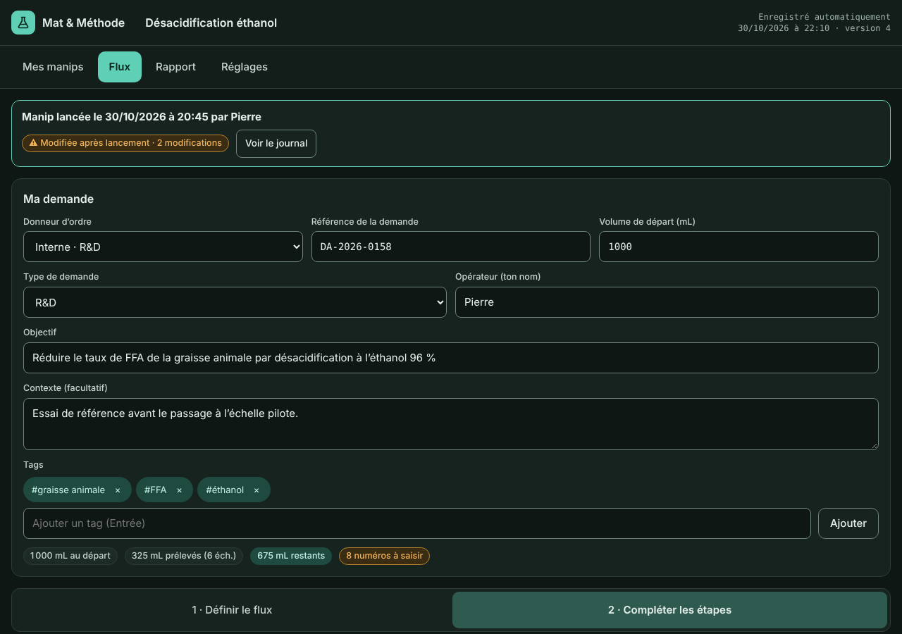
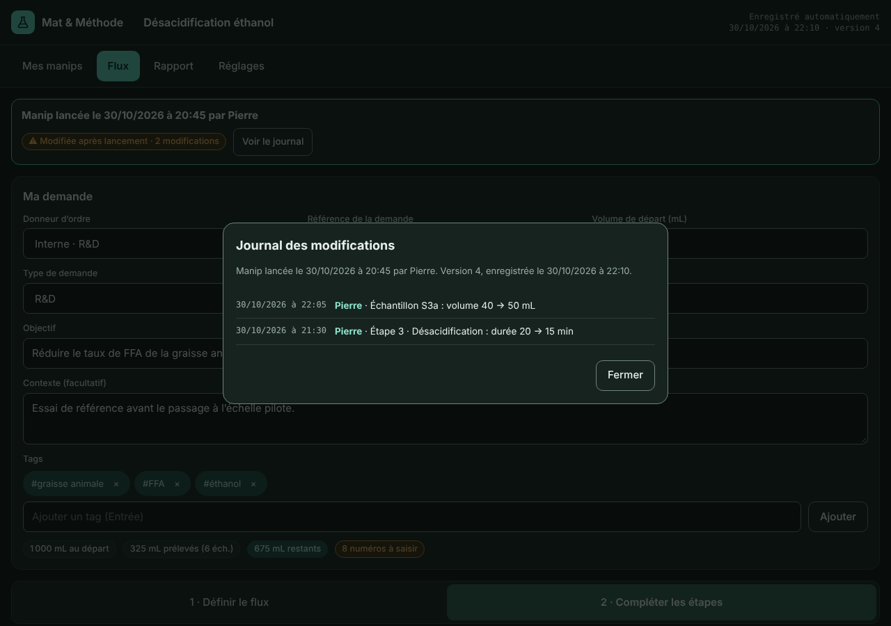

---

## 9. Architecture technique

**Plateforme : application de bureau Windows 11 uniquement, livrée en un seul fichier `.exe` portable, déposé sur SharePoint. Pas d'installateur, pas de version web ni mobile.**

**Séparer strictement** la logique métier de l'interface.

```text
mat_methode/
  domain/      modèles (pydantic), règles §8 (étiquettes, bilan, communes, défauts labo)
  report/      génération du texte §10, tables, Markdown / HTML
  exports/     export_pdf (reportlab, schéma du flux), export_word (python-docx), export_json, import_json
  extraction/  lecture d'un rapport PDF (pdfplumber) -> JSON
  storage/     fichiers JSON dans le dossier partagé, verrous, détection de conflit, sauvegardes (pas de SQLite)
  ui/          interface PySide6 (pages : Mes manips, Flux, Rapport, Réglages ; dialogues)
tests/         pytest + pytest-qt, golden files = exemples/
  build/         PyInstaller (.spec), build.ps1
```

**Choix techniques (valeurs par défaut)**
- **Python 3.12, 64 bits** ; `pydantic` v2, `reportlab`, `python-docx`, `Pillow`, `pdfplumber`, `pytest`, `pytest-qt`, `ruff`.
- **Interface : PySide6 (Qt 6) + PySide6-Fluent-Widgets** (bibliothèque Fluent Design : NavigationView, CommandBar, ToggleSwitch, ComboBox, NumberBox, InfoBar, dialogues, thème clair/sombre, couleur d'accentuation Windows, effet Mica). **Licence** : cette bibliothèque est en GPLv3 pour un usage non commercial et sous licence payante sinon. Si l'application sert dans une entreprise, soit acheter la licence, soit utiliser **PySide6 seul avec une feuille de style Qt (QSS) Fluent maison** reprenant les valeurs du §13. À trancher avec l'utilisateur (§15).
- **Stockage partagé (multi-utilisateurs, tout à côté de l'application)** : voir §9.1. **Pas de SQLite** : une base SQLite sur SharePoint ou un dossier synchronisé se corrompt dès que deux personnes l'ouvrent. Un fichier JSON par manip à la place.
- **Word** : `python-docx` + `Pillow` (schéma du flux en image), voir `scripts/export_word.py`.
- **PDF** : `reportlab`, police **Segoe UI** (`C:\Windows\Fonts\segoeui.ttf` / `segoeuib.ttf`) puis Arial, Liberation Sans, DejaVu (déjà géré dans `scripts/export_pdf_flux.py`). Sans police TrueType, le « µ » disparaît.
- **Packaging (portable, sans installateur)** : **PyInstaller `--onedir --windowed`** (et **non** `--onefile`, voir §9.1 : le mode un-seul-fichier se décompresse dans le dossier temporaire de Windows, ce que la contrainte interdit), construit **sur un Windows 11 64 bits** (pas de compilation croisée), dans un environnement virtuel propre, avec icône `.ico` et fichier de version. Résultat : un dossier `MatMethode\` contenant `MatMethode.exe` et `_internal\`, déposé sur SharePoint avec le dossier de données (§9.1). Polices et icônes sont embarquées dans le `.spec` (`datas`). Documenter l'avertissement SmartScreen / antivirus (fichier non signé : « Informations complémentaires » puis « Exécuter quand même », ou « Débloquer » dans les propriétés des fichiers) et prévoir de demander à l'informatique d'autoriser l'`.exe`.
- **Build** : `build/build.ps1` reproductible (création du venv, `pip install -r requirements.txt`, `pytest`, `pyinstaller MatMethode.spec`, calcul du SHA-256 de l'`.exe`). Numéro de version affiché dans « À propos » pour savoir quelle version est sur SharePoint.
- **Mises à jour** : manuelles dans le MVP : on remplace le dossier de l'application sur SharePoint (nom avec la version, ex. `MatMethode_1.2\`), **le dossier de données est conservé et partagé**. Chaque fichier de données porte un `schema` ; l'application les **migre automatiquement** (avec sauvegarde avant migration) et **refuse d'ouvrir** des données plus récentes que sa version (« Mets à jour l'application »).


### 9.1 Données partagées et fichiers temporaires dans le dossier de l'application

**Contrainte** : l'application est utilisée par **plusieurs personnes**, depuis SharePoint ; **tous les fichiers**, y compris les temporaires, doivent rester **dans le dossier de l'application**. Rien n'est écrit dans `%APPDATA%`, `%TEMP%` ni ailleurs (sauf ce que Windows crée lui-même).

```text
MatMethode_1.0\                 dossier SharePoint (à synchroniser sur chaque PC)
  MatMethode.exe
  _internal\                       librairies (PyInstaller --onedir)
  donnees\                         partagé par tous les utilisateurs
    reglages.json                  laboratoires, réactifs, analyses, donneurs, types, états
    manips\<id>.json               UNE manip = UN fichier (évite que deux personnes écrasent le même fichier)
    verrous\<id>.lock              qui édite quelle manip (voir ci-dessous)
    preferences\<utilisateur>.json thème, dernière manip, taille de fenêtre (propres à chacun)
    sauvegardes\AAAA-MM-JJ\       copie datée (1re ouverture du jour), 10 jours conservés
    exports\                       PDF / Word / JSON créés (dossier proposé par défaut)
    logs\                          journal par utilisateur et par jour
  temp\                            TOUT le temporaire : vidé au démarrage et à la fermeture
```

Règles :
- **Fichiers temporaires** : dès le démarrage, avant tout import de librairie qui écrit, définir `TMP`, `TEMP` et `tempfile.tempdir` sur `<dossier de l'application>\temp`. Les écritures atomiques (`fichier.tmp` puis `os.replace`) se font **dans le même dossier que le fichier visé**. Aucun `QSettings` dans le registre (utiliser `preferences\`). Aucun cache de police ou d'image hors du dossier.
- **Retrouver le dossier** : en `.exe` (`sys.frozen`), c'est `Path(sys.executable).parent`, **jamais** `__file__` ni le dossier courant.
- **Identité** : nom d'utilisateur Windows (`getpass.getuser()`), affiché dans « modifiée par … », dans les verrous et utilisé comme opérateur par défaut.
- **Verrou d'édition** : à l'ouverture d'une manip en modification, créer `verrous\<id>.lock` (`{utilisateur, pc, depuis, battement}`) et mettre `battement` à jour toutes les 30 s ; le supprimer à la fermeture. Un verrou sans battement depuis **3 minutes** est considéré comme abandonné (plantage, PC éteint). Si une manip est verrouillée par un autre : bandeau « Modifiée en ce moment par Marie (depuis 11:40) », **ouverture en lecture seule**, avec « Dupliquer pour travailler dessus ». Le verrou est une **aide** : la synchronisation SharePoint a du retard, donc le contrôle de révision ci-dessous reste la vraie protection.
- **Contrôle de révision** : chaque manip porte `rev` (entier) et `modifie_par`. Avant d'enregistrer, relire le fichier ; si `rev` sur le disque ≠ `rev` chargé, **ne pas écraser** : proposer « Recharger la version de Marie », « Enregistrer ma version comme copie » (nommée « … (copie de Pierre) »). Si les deux sont identiques, enregistrer avec `rev + 1`.
- **Réglages partagés** : même contrôle de révision ; en cas de conflit, **fusion automatique des listes** (union des laboratoires, réactifs, analyses, donneurs, types, états ajoutés par chacun ; une suppression n'est appliquée que si elle porte sur une entrée non modifiée par l'autre) et message d'information.
- **Fichiers de conflit** SharePoint / OneDrive (`manip-PC-NOM.json`, `… (conflit …)`) : détectés au démarrage, signalés dans un bandeau « 1 conflit de synchronisation à vérifier », jamais supprimés par l'application.
- **Liste des manips** : lecture de tous les `manips\*.json` au démarrage et au bouton « Actualiser » (pas de base d'index) ; un fichier illisible est ignoré avec un avertissement et n'empêche jamais l'ouverture des autres. Rafraîchissement automatique toutes les 60 s.
- **Enregistrement** : automatique (< 1 s après la modification), écriture atomique. Un indicateur affiche « Enregistrement… / Enregistré / Dossier inaccessible ».
- **Dossier inaccessible ou en lecture seule** (hors-ligne, droits) : l'application s'ouvre quand même en **lecture seule** avec un message clair, sans rien perdre ; les modifications en cours sont gardées en mémoire et proposées à l'enregistrement au retour du dossier.
- **Mise en place demandée aux utilisateurs** : dans SharePoint, **« Synchroniser »** le dossier, puis clic droit sur le dossier, **« Toujours conserver sur cet appareil »** (sinon Windows ne télécharge les fichiers qu'à l'ouverture, ce qui ralentit ou bloque l'application). Lancer l'`.exe` depuis le dossier synchronisé, **jamais depuis le navigateur**.
- **Droits SharePoint** : tous les utilisateurs ont le droit de **modification** sur tout le dossier (données, verrous, temp, sauvegardes).
- **Export / import JSON complet** conservés (sauvegarde manuelle, partage hors du dossier).

---

## 10. Génération du texte « Matériel et méthodes »

Sections, dans l'ordre : **2.1 Échantillon**, **2.2 Matériel et réactifs**, **2.3 Méthodes**, **2.4 Prélèvements** (si des échantillons existent), puis **Détail par phase du flux**, puis les tableaux récapitulatifs Réactifs et Échantillons.

**Détail par phase du flux** : une fiche pour **Départ** (échantillons avant traitement seulement) puis une par étape, dans l'ordre du flux. Chaque fiche contient : titre (numéro et opération), conditions (même résumé que la carte de l'étape, avec les autres conditions), matériel, **réactifs** (nom, quantité ou ratio, n° Scirius, emplacement, fournisseur, lot ; « aucun » s'il n'y en a pas), **échantillons** (étiquette, volume, moment, laboratoire, analyses, n° Scirius, n° Aramis ; « aucun » sinon). Les valeurs manquantes sont « à saisir ». C'est la même information que les tableaux récapitulatifs, **regroupée par phase** ; les deux doivent rester cohérents (une seule source de données). En Markdown : un titre `#### 3 · Désacidification` par phase, puis des listes « Conditions / Matériel / Réactifs / Échantillons ».

**Références aux étapes (obligatoire dans les chapitres, donc dans tous les exports : PDF, Word, Markdown, HTML)** : chaque chapitre dit à quelle étape du flux il se rapporte, avec le numéro tel qu'il apparaît sur les cartes du flux (« étape 3 », « étapes 3, 4 »). Les numéros se recalculent seuls si on insère, déplace ou supprime une étape.

Règles :
- Toute donnée manquante devient un **repère** `{{?libellé}}` affiché en pastille orange « libellé à saisir » dans l'application et `[libellé à saisir]` dans le Markdown. **Ne jamais inventer** une valeur.
- **2.1** : « Demande : donneur d'ordre, type … (réf. …). Objectif : …. Idée testée : …. Contexte : …. Matière étudiée : … (lot …). Volume de départ : … mL, dont … mL prélevés sous forme de n échantillons. Le flux comporte n étapes (étapes 1 à n), décrites en 2.3. » Les phrases Objectif, Idée testée (type « test » seulement) et Contexte **n'apparaissent que si le champ est rempli** ; la ponctuation finale saisie est retirée pour éviter « .. ».
- **2.2** : « Matériel : liste dédupliquée des équipements de toutes les étapes, **chacun suivi de ses étapes** (« Entonnoir Büchner (étape 2), Ampoule à décanter 500 mL (étapes 3, 4) »). Réactifs : nom (**étape 3**, fournisseur …, lot …) ; … ».
- **2.3** : une phrase par étape, **qui commence par son numéro** : « Étape 1 : le produit a été … ». Suivantes : « Étape 2 : il a ensuite été … ». Participe passé par opération : chauffé, filtré, désacidifié, décanté, séché, centrifugé, lavé, broyé, extrait ; sinon « traité (nom de l'étape) ». Compléments dans cet ordre : membrane (« sur membrane de 5 µm »), réactifs (« en présence d'éthanol 96 % (1 : 1 (v/v)) et d'eau distillée … » avec élision **d'** devant voyelle ou h), température (« à 60 °C »), durée (« pendant 30 min », « 2 h », « 1 h 30 »), sous vide (« sous vide (50 mbar) »), agitation (« sous agitation (300 tr/min) », « à 4000 tr/min » pour une centrifugation), autres conditions (« pH 7 »), remarque entre parenthèses.
- **2.4** : par échantillon : « Un échantillon de 50 mL (S3a) a été prélevé pendant l'étape 3 (désacidification), à 10 min, puis analysé au Labo interne (analyses) [n° Scirius …, n° Aramis …]. » ; « à l'effluent de l'étape n (…) » ; « avant traitement (entrée du flux) ». Le « Détail par phase du flux » est déjà numéroté par étape.
- Durées : < 60 min en « min », multiples de 60 en « h », sinon « 1 h 05 ».

**Dates et heures** : toutes affichées en heure locale, format `JJ/MM/AAAA à HH:MM` ; stockées en UTC (ISO 8601 avec `Z`). Les tests comparent la sortie à la référence en **fixant le fuseau sur Europe/Paris** et en gelant l'horloge.

**Sortie de référence** : `exemples/rapport_attendu.md` (et `.html`) pour la manip d'exemple. Les tests doivent comparer la sortie à ce fichier.

---

## 11. Exports

**Les deux exports principaux sont le PDF et le Word.** Même contenu dans les deux, dans cet ordre : titre, bandeau (donneur d'ordre, **type de demande**, référence, date, une ligne **Tags** s'il y en a, et la ligne **Version n · enregistrée le … · lancée le … par …** avec la mention **Modifiée après lancement (n)**), schéma du flux, « Matériel et méthodes » (2.1 à 2.4), « Détail par phase du flux », tableaux Réactifs et Échantillons, pied de page. Les valeurs manquantes sont en orange « à saisir » dans le PDF et **surlignées en jaune** dans le Word, pour être complétées à la main.

| Format | Contenu | Référence |
|---|---|---|
| **PDF** (principal) | voir ci-dessous | `exemples/pdf_export_avec_flux.pdf`, V13 |
| **Word .docx** (principal) | voir « Word » ci-dessous ; modifiable par l'utilisateur | `exemples/word_export_exemple.docx`, `scripts/export_word.py` |
| **Texte Markdown** | titre, donneur d'ordre, sections 2.1–2.4, détail par phase du flux, tableaux Réactifs et Échantillons | `exemples/rapport_attendu.md` |
| **Rapport HTML imprimable** | même contenu + flux en cartes, mise en page claire pour impression | `exemples/rapport_attendu.html` |
| **JSON d'échange** | §7 | `exemples/manip-pour-script-pdf.json` |

### PDF avec flux (V13)
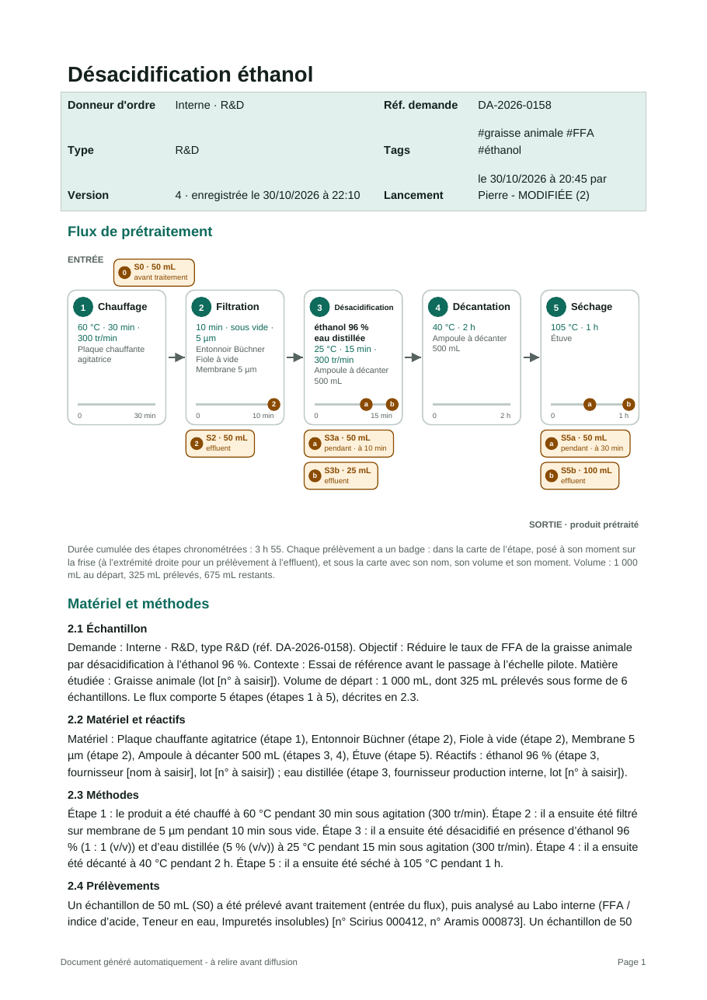

Document A4 de 2 à 3 pages : titre, bandeau (donneur d'ordre, référence), **schéma du flux** (5 cartes par ligne, retour à la ligne avec coude, flèches), légende (durée cumulée, bilan de volume), texte M&M, **détail par phase du flux** (une fiche par phase : conditions et matériel, réactifs avec n° Scirius et emplacement, échantillons avec labo, analyses, numéros ; une fiche n'est jamais coupée entre deux pages), tableau **Réactifs**, tableau **Échantillons**, et, si la manip a été lancée, la section **Modifications après lancement**. Dans le schéma :
- carte d'étape : numéro, nom, réactifs (gras), conditions (vert), matériel (gris) ;
- **frise** dans la carte (0 → durée) avec les **badges** des échantillons à leur moment ; les **noms** (S3a · 50 mL, moment) sont écrits **sous la carte**, avec le même badge, empilés s'il y en a plusieurs ;
- « ENTRÉE » avec ses prélèvements avant traitement, « SORTIE ».
Les champs manquants sont affichés en orange « à saisir ». Un tableau trop long passe à la page suivante d'un seul tenant.

### Word (.docx)
Document A4, marges 2 cm, police Segoe UI 10 pt, titres en vert (#0F6B5C). Fait avec `python-docx` (`scripts/export_word.py`, qui prend le même JSON que le PDF) :
- le **schéma du flux** est inséré comme **image PNG** (dessinée avec Pillow : cartes, frise, badges, noms des échantillons sous les cartes) avec un texte alternatif ; le reste du document est du **vrai texte** modifiable ;
- le texte M&M en paragraphes avec les titres 2.1 à 2.4 (styles Titre 3) ;
- « Détail par phase du flux » : un petit **tableau par phase** (Départ, puis chaque étape) avec les lignes Conditions, Réactifs, Échantillons ;
- tableaux **Réactifs** et **Échantillons** (en-tête vert clair, largeurs de colonnes fixes) ;
- pied de page « Document généré automatiquement - à relire avant diffusion » ;
- les « à saisir » sont **surlignés en jaune** (ne rien inventer) ;
- l'utilisateur doit pouvoir **ouvrir et modifier** le fichier dans Word, et il doit s'afficher correctement aussi dans LibreOffice.
Le nom de fichier proposé est `<titre-de-la-manip>.docx` (et `.pdf`), dans le dossier choisi par l'utilisateur (boîte « Enregistrer sous » Windows, dernier dossier mémorisé).

---

## 12. Import d'un ancien rapport PDF

`scripts/extract_mm.py` lit un PDF **textuel** et isole la section « Matériel et méthodes » : retire les en-têtes/pieds de page répétés, ignore le sommaire, s'arrête au titre suivant, découpe en sous-sections, détecte matériel, réactifs et **étapes** (opération, température, durée, agitation, ratio, membrane ; le « sous vide » n'est pas encore détecté, à ajouter) et écrit un JSON + un Markdown. Les étapes ambiguës sont marquées `a_verifier`. Exemple : `exemples/rapport_exemple.pdf` → `exemples/mm_extrait.json`.

À faire dans l'application : bouton « Importer un ancien rapport » (JSON, puis directement un PDF), création d'une manip Brouillon, affichage des étapes `a_verifier` pour relecture, ajout des réactifs détectés à la liste des Réglages.
**Limites connues** : règles par mots-clés (pas de compréhension du texte), un PDF scanné nécessite une reconnaissance de texte (hors MVP).

---

## 13. Design : Windows 11 (Fluent)

L'application suit **Windows 11** : thème **clair ou sombre selon le réglage de Windows**, **couleur d'accentuation de Windows** pour les boutons et la sélection, effet **Mica** et barre de titre intégrée si disponibles (repli : fond uni). Maquettes : `visuels/windows11/W01` à `W07`.

| Rôle | Clair | Sombre |
|---|---|---|
| Fond de fenêtre (Mica) | `#F3F3F3` | `#202020` |
| Volet de navigation | `#EEEEEE` | `#1C1C1C` |
| Carte | `#FFFFFF`, trait `#E5E5E5` | `#2B2B2B`, trait `#3A3A3A` |
| Texte | `#1A1A1A` ; secondaire `#5F5F5F` | `#FFFFFF` ; secondaire `#D0D0D0` |
| Accentuation (par défaut) | `#0067C0` (texte blanc) | `#60CDFF` (texte `#00283D`) |
| Sélection | `#E4E4E4` + barre d'accent 3 px | `#333333` + barre d'accent |
| Prélèvements et « à saisir » (ambre) | texte `#8A4B00` sur `#FFF4CE`, trait `#D9A93E` | `#F7C46C` sur `#4A3510`, trait `#A8802A` |
| Succès / danger | `#0F7B0F` sur `#DFF6DD` / `#C42B1C` | `#6CCB5F` / `#FF99A4` |

- **Typographie** : **Segoe UI Variable** (texte 14 px, sous-titre 20 px semi-gras, titre de page 28 px semi-gras) ; **Cascadia Mono** ou Consolas pour valeurs, numéros Scirius/Aramis, durées.
- **Contrôles** : hauteur 32 px, rayon 4 px ; cartes et dialogues rayon 8 px ; marges de contenu 36 px ; espacement 8/12/16 px. Fenêtre par défaut 1360 × 860, minimum 1100 × 700.
- **Icônes** : Segoe Fluent Icons (ou icônes Fluent de la bibliothèque). Pas d'emoji.
- **Clavier** : tout est utilisable sans souris (Tab, Maj+Tab, Entrée, Espace, Échap) ; raccourcis : `Ctrl+N` nouvelle manip, `Ctrl+F` recherche, `Ctrl+E` exporter, `Ctrl+Z` annuler la dernière suppression, `Alt+←/→` étape précédente/suivante.
- **Accessibilité** : libellé visible sur chaque champ, focus visible, contraste conforme, thème à contraste élevé de Windows respecté, noms accessibles pour le lecteur d'écran (UI Automation via Qt), mise à l'échelle 100 à 200 %.
- **Règles de sens** : la couleur n'est jamais seule porteuse de sens (texte ou forme en plus) ; l'ambre est réservé aux prélèvements et aux champs à saisir.

---

## 14. Défauts connus du prototype à corriger dans l'application

1. **Texte** : doubles parenthèses « (1 : 1 (v/v)) » → écrire « 1 : 1, v/v » ; majuscule initiale inutile dans la liste du matériel (« Plaque chauffante… ») ; répétition de « Il a ensuite été » → varier (« puis », « enfin ») ; accord masculin unique (« Le produit ») ; la phrase « filtré sur membrane de 5 µm pendant 10 min sous vide » mérite un ordre plus naturel.
2. **Étiquettes** : faire valider par l'utilisateur le principe « S + n° d'étape » (un seul échantillon à l'étape 2 s'appelle S2, deux à l'étape 3 s'appellent S3a et S3b).
3. **Laboratoire par défaut** : le prototype reprend celui du dernier échantillon ; prévoir un laboratoire par défaut au niveau de la manip si l'utilisateur le demande.
4. **Contrôles de saisie** : valider les formats Scirius/Aramis une fois connus ; alerter sur les doublons ; signaler une durée de prélèvement supérieure à la durée de l'étape.
5. **Réactifs** : la suppression d'un nom dans Réglages efface aussi son n° Scirius/emplacement mémorisés ; prévoir un message de confirmation.
6. **PDF** : étapes très longues (plus de 5 réactifs ou conditions) → la carte déborde ; prévoir carte plus haute ou réduction de police.
7. **Accessibilité** : le prototype n'a pas de piège de focus dans les fenêtres ; l'ajouter.

---

## 15. Questions à poser à l'utilisateur avant de coder

1. ~~Plateforme cible~~ : **réponse reçue** : PC **Windows 11 uniquement**, Python transformé en `.exe` **portable (sans installateur), déposé sur SharePoint**, design Windows 11. Reste à confirmer : **licence** de la bibliothèque Fluent (§9) si usage en entreprise.
2. **Formats des numéros Scirius et Aramis** (nombre de chiffres, préfixes) et règles d'unicité.
3. **Où se trouvent aujourd'hui** les réactifs (n° Scirius, emplacements) : fichier Excel, export d'un logiciel ? Import à prévoir ?
4. **Rapports PDF réels** à fournir (anonymisés) pour régler l'extraction ; sont-ils parfois scannés ?
5. **Laboratoire par défaut** par manip ? Plusieurs utilisateurs ?
6. Faut-il un **PDF directement dans l'application** (oui par défaut) et un export **Word** ?
7. Les données restent-elles **sur le PC** (par défaut) ou doivent-elles être **partagées** entre plusieurs PC (dossier réseau, SharePoint) ?

---

## 16. Feuille de route

- **MVP** : tout ce qui est décrit §6 à §12, stockage local, tests sur les fichiers d'exemple.
- **V1.1** : extraction directe d'un PDF dans l'application, import de l'inventaire des réactifs, validations Scirius/Aramis, laboratoire par défaut par manip.
- **V2** : OCR des PDF scannés, plusieurs utilisateurs, export Word, impression d'étiquettes, synchronisation.

---

## 17. Critères d'acceptation (à transformer en tests)

1. Ouvrir la manip d'exemple « Désacidification éthanol » : 5 étapes, 6 échantillons, 325 mL prélevés, 675 mL restants, 8 numéros à saisir (S0 complet, S3a Aramis manquant, etc., voir les données).
2. Générer le Markdown : identique à `exemples/rapport_attendu.md` (après correction des défauts §14 si validée par l'utilisateur, mettre à jour ce fichier).
3. Étiquettes : étape 3 avec deux échantillons → S3a (pendant, 10 min) puis S3b (effluent) ; supprimer l'un des deux renomme l'autre « S3 ».
4. Conditions communes : activer « Agitation 250 » puis appliquer à une manip dont 2 étapes ont déjà 300 → seules les étapes vides passent à 250 ; avec « Remplacer aussi » toutes passent à 250, **sauf la centrifugation**.
5. Insérer une étape après l'étape 1 : elle devient l'étape 2, les échantillons suivent leurs étapes, les étiquettes se recalculent.
6. Changer le laboratoire d'un échantillon applique volume et analyses du laboratoire.
7. Dupliquer une manip : la copie n'a ni référence, ni lot, ni numéros Scirius/Aramis ; le reste est identique.
8. Le donneur d'ordre et le nom d'un réactif ne peuvent pas être saisis librement dans une manip.
9. Exporter le PDF : une page lisible, frise et badges présents, « µ » correctement affiché, tableau Échantillons complet.
10. Importer `exemples/mm_extrait.json` : 5 étapes créées, réactifs « éthanol 96 % » et « eau distillée » ajoutés à la liste des Réglages.
11. Fermer et rouvrir l'application : toutes les données sont conservées dans `donnees\` (à côté de l'`.exe`), et une sauvegarde datée existe dans `donnees\sauvegardes\`.
12. **Dossier portable sur un Windows 11 neuf sans Python** : le dossier synchronisé depuis SharePoint se lance en moins de 5 s ; au premier lancement il crée `donnees\` et `temp\` **dans son propre dossier**.
13. L'interface **suit le thème clair/sombre de Windows** et la couleur d'accentuation ; elle reste lisible à 100 %, 150 % et 200 % de mise à l'échelle.
14. Tout est utilisable **au clavier** ; les raccourcis du §13 fonctionnent.
15. L'export PDF depuis l'`.exe` affiche correctement « µ », « ° » et les accents (police Segoe UI embarquée).
16. **Le rapport est organisé par phase** (écran, Markdown, HTML, PDF) : une fiche « Départ » puis une par étape ; sur l'exemple, la phase 3 liste ses 2 réactifs (n° Scirius, emplacement) et ses 2 échantillons S3a et S3b, et les phases 1 et 4 indiquent « aucun » pour les réactifs.
17. **Export Word** : « Exporter en Word » crée un .docx qui s'ouvre dans Word sans avertissement, avec le schéma du flux, les fiches par phase, les tableaux Réactifs et Échantillons, les « à saisir » surlignés en jaune, et un texte modifiable (hors schéma). Même contenu que le PDF.
18. **Export PDF et Word depuis l'`.exe`** : les deux boutons du Rapport fonctionnent sans Python installé ; le fichier s'enregistre à l'endroit choisi ; « µ », « ° » et accents sont corrects dans les deux formats.
19. **Références aux étapes** : dans le texte généré (écran, PDF, Word, Markdown, HTML), 2.1 indique le nombre d'étapes, 2.2 indique l'étape de chaque matériel et réactif, 2.3 commence chaque phrase par « Étape n : » ; sur l'exemple, « Ampoule à décanter 500 mL (étapes 3, 4) » et « éthanol 96 % (étape 3, …) ». Insérer une étape au début décale tous les numéros.
20. **Titres d'étape longs** : avec une étape nommée « Chauffage préalable de la graisse brute » et une autre « Électrocoagulation », le titre passe à la ligne (écran, PDF, Word) ou rétrécit un peu, sans mot coupé ni texte qui déborde de la carte, et sans chevaucher les réactifs ou la frise.
21. **Tag par donneur d'ordre** : dans Mes manips, un bouton coloré par donneur d'ordre avec son compteur ; cliquer sur « Interne · Production » ne montre que ses manips (1 sur l'exemple) ; chaque manip affiche le tag coloré de son donneur ; une couleur ne change pas quand on filtre.
22. **États modifiables** : dans Réglages, renommer « En cours » en « En attente de résultats » et le passer en rouge met à jour toutes les manips concernées ; supprimer le premier état déplace ses manips vers le nouveau premier état ; on ne peut pas supprimer le dernier état ; « Archivée » n'est pas dans la liste.
23. **Contexte et tags** : choisir le type « Test d'idée » fait apparaître « Idée testée » ; choisir « R&D » le masque ; saisir `nouveau tag, pilote` puis Entrée crée 2 tags et garde le curseur dans le champ ; le type, l'objectif et les tags apparaissent dans le texte 2.1, dans le bandeau PDF et Word, et sont conservés après duplication, export JSON et réimport.
24. **Aucun fichier hors du dossier** : pendant une session complète (création de manip, export PDF et Word, import, sauvegarde), un outil de surveillance (Process Monitor) ne montre **aucune écriture** dans `%APPDATA%`, `%LOCALAPPDATA%` ni `%TEMP%` par l'application ; tout ce qui est créé est dans `donnees\` ou `temp\`. `temp\` est vide après la fermeture.
25. **Deux utilisateurs** : Pierre ouvre la manip A ; Marie l'ouvre ensuite : elle est en **lecture seule** avec le message « Modifiée en ce moment par Pierre ». Pierre ferme : le verrou disparaît. Si l'`.exe` de Pierre est arrêté de force, le verrou expire en 3 minutes.
26. **Conflit** : Pierre et Marie modifient la même manip ; le second à enregistrer voit la fenêtre de conflit et **aucune modification n'est perdue** (recharger ou enregistrer comme copie). Deux personnes qui modifient **deux manips différentes** ne se gênent jamais.
27. **Réglages partagés** : un réactif ajouté par Marie apparaît chez Pierre après actualisation, sans écraser le laboratoire que Pierre vient d'ajouter.
28. **Dossier hors-ligne** : sans accès au dossier, l'application s'ouvre en lecture seule avec un message clair et ne plante pas ; au retour du dossier, les modifications en attente sont proposées à l'enregistrement.
29. **Enregistrement automatique visible** : aucun bouton Enregistrer ; après une modification, l'en-tête passe par « Enregistrement automatique… » puis affiche « Enregistré automatiquement · date à heure · version n » avec n augmenté de 1 ; la date et l'heure sont toujours visibles sur tous les écrans.
30. **Lancement** : lancer une manip affiche « Manip lancée le … par … » et « Aucune modification depuis le lancement » ; changer une température de 25 à 30 °C ajoute dans le journal, après environ une seconde, « Étape 3 · Désacidification : température 25 → 30 °C » avec la date, l'heure et le nom ; la pastille orange « Modifiée après lancement · 1 modification » apparaît dans Flux, Rapport et Mes manips.
31. **Journal fiable** : taper « 30 » dans un champ ne crée qu'**une** ligne ; supprimer l'étape 4 crée « Étape supprimée » mais **pas** de « déplacée » pour l'étape suivante ; une modification faite juste avant la fermeture de l'application est retrouvée à la réouverture ; une modification avant lancement n'est jamais journalisée ; le journal ne peut ni se modifier ni se vider ; « Annuler le lancement » n'existe que si le journal est vide.
32. **Exports** : le PDF, le Word, le Markdown, le HTML et le JSON d'une manip lancée et modifiée contiennent la ligne de version, la mention « Modifiée après lancement (n) » et la section « Modifications après lancement » avec toutes les lignes ; une manip non lancée n'a ni cette mention ni cette section, mais a la ligne de version.

---

## 18. Contenu du dossier

```text
CAHIER_DES_CHARGES.md          ce document
prototype/index.html           prototype web fonctionnel (référence du COMPORTEMENT ; l'apparence suit les maquettes Windows 11)
visuels/windows11/              W01 à W07 : maquettes Windows 11 (design de référence, clair et sombre)
visuels/                       V01 à V09 et V13 à V15 : captures du prototype web (comportement) et du PDF ; V10 à V12 : version mobile du prototype, non retenue (PC uniquement)
scripts/
  extract_mm.py                extraction de la section M&M d'un PDF
  export_pdf_flux.py           PDF avec schéma du flux (reportlab)
  export_word.py               Word .docx avec schéma du flux en image (python-docx, Pillow)
  make_sample_report.py        génère un rapport PDF fictif pour tester l'extraction
exemples/
  rapport_exemple.pdf          PDF fictif de rapport
  mm_extrait.json / .md        sortie de l'extraction
  manip-pour-script-pdf.json   export JSON d'une manip (entrée du PDF)
  pdf_export_avec_flux.pdf     PDF produit
  word_export_exemple.docx         Word produit
  rapport_attendu.md / .html   sorties de référence du texte
  donnees_exemple_complete.json  toutes les données du prototype (manips, réglages)
```

Les valeurs d'exemple (n° Scirius/Aramis, emplacements, noms de laboratoires, résultats) sont **fictives**.
